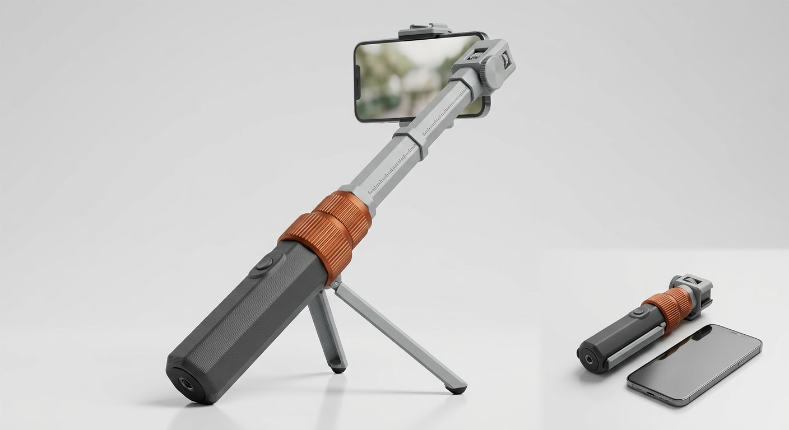
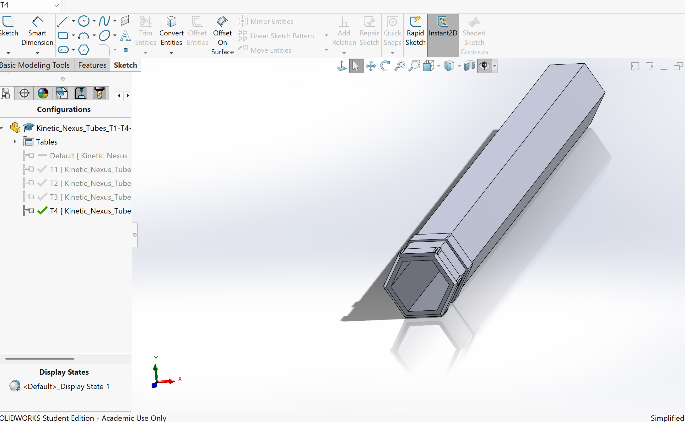

## Hacklife Kinetic-Nexus

# Pourpose
**Kinetic Nexus** is a SolidWorks CAD project for a compact hexagonal "telescoping" selfie stick. Build for Hack Club **Half-Life** hardware program.


## Project status

### Completed 
- Parametric telescoping tubes Tube 1 to 4 (T1-T4) (all tubes)
- Configuration specific demensions
- J1 external threaded bosse into T1
- J1 collet
- J1 locking nut (for T1 , Collet, and Locking nut)
- J1 assembly, exploded view


  ### Still To Be Completed
  - J2 (locking joint between  T2 and T3
  - J3 locking joint betweeb T3 and T4
  - Ruler markings
  - T1 grip and tripod mechanism
  - Phone mount, (tilited head and clam)
  - Assembly of all parts
  - Physical comfirmation


## Visual overview 

### 3D renders
| 2D Visualization | 3D Visualization |
| :---: | :---: |
|  |  | 

## T1-T4 Tube Configurations


## J1 Locking Joint Assembely + Exploded View
| J1 Assembly | J1 Exploded View | 
| :---: |  :---: | 
|   |  |

## Documentation

- [`JOURNAL.md`](JOURNAL.md) — Engineering log and project development timeline.
- [`BOM.csv`](BOM.csv) — Bill of Materials (to be populated as hardware and manufacturing requirements are finalized).
- [Build Specification (PDF)](<docs/Kinetic-Nexus Build Specification (1) (1).pdf>) — Full build and tolerance specification.
- [Thread & Nut Equations (TXT)](<docs/equations_KINETIC_NEXUS_NUTS.txt>) — Parametric equations for the J1 thread and nut geometry.
---
## Disclaimer
Ai was used to guide the build process, equations  and with the images (soon to be replaced
## Repository Structure

```text
Hack-Life-Kinetic-Nexus/
├── README.md
├── JOURNAL.md
├── BOM.csv
├── LICENSE
├── assets/
│   ├── 2D Visualization.jpg
│   ├── 2d-visualization-with-tripod.jpg
│   ├── 3D Visualization.jpg
│   ├── J1_asembly.png
│   ├── T1-T¤ config.png
│   └── j1-exploded.png
├── Cad/
│   ├── native-solidworks/
│   │   ├── Kinetic_Nexus_J1_Assembly.STEP
│   │   ├── Kinetic_Nexus_J1_Collet.SLDPRT
│   │   ├── Kinetic_Nexus_J1_Locking_Nut_saved=.SLDPRT
│   │   ├── Kinetic_Nexus_J1_Mating_Test.SLDASM
│   │   ├── Kinetic_Nexus_J1_Test_Assembly.SLDASM
│   │   └── Kinetic_Nexus_Tubes_T1-T4+J1_FINAL.SLDPRT
│   └── step/
│       ├── Kinetic_Nexus_J1_Assembly.STEP
│       ├── Kinetic_Nexus_J1_Collet_step.STEP
│       ├── Kinetic_Nexus_J1_External_Thread_Verified_step.STEP
│       ├── Kinetic_Nexus_J1_Locking_Nut_saved_step.STEP
│       ├── Kinetic_Nexus_J1_Test_Assembly_step.STEP
│       └── Kinetic_Nexus_Tubes_T1-T4+J1_FINAL_step.STEP
└── docs/
    ├── Kinetic-Nexus Build Specification (1) (1).pdf
    ├── Kinetic_Nexus_T2_SolidWorks_Handoff.docx
    └── equations_KINETIC_NEXUS_NUTS.txt

